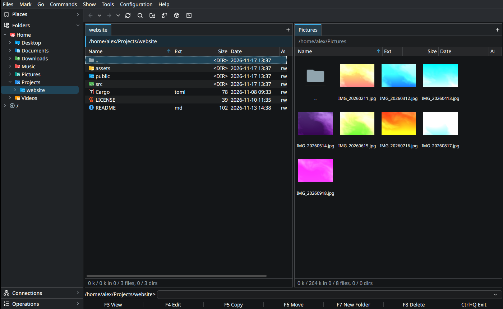
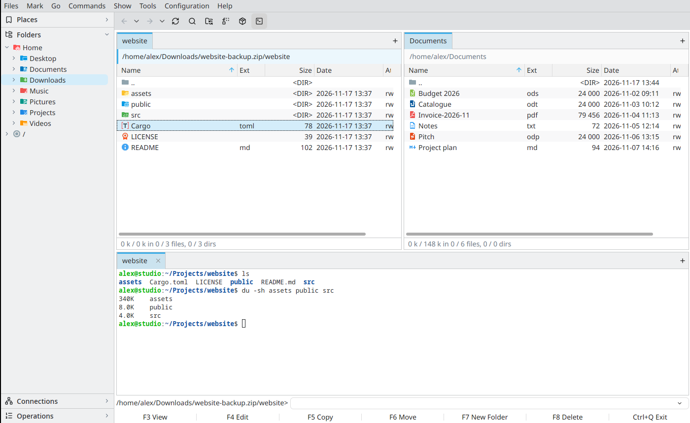
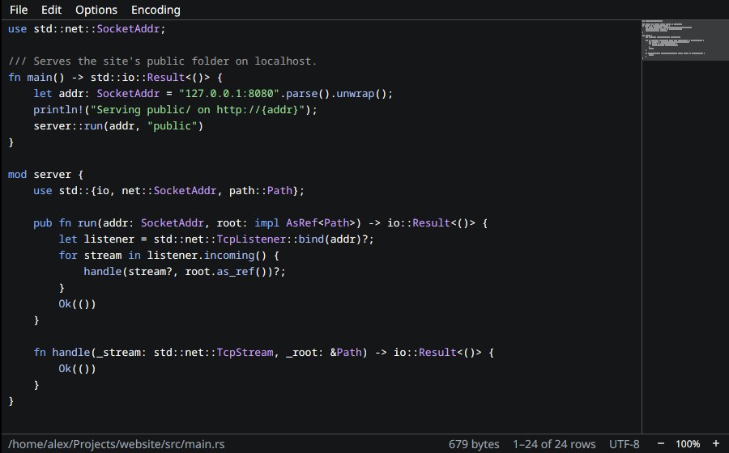
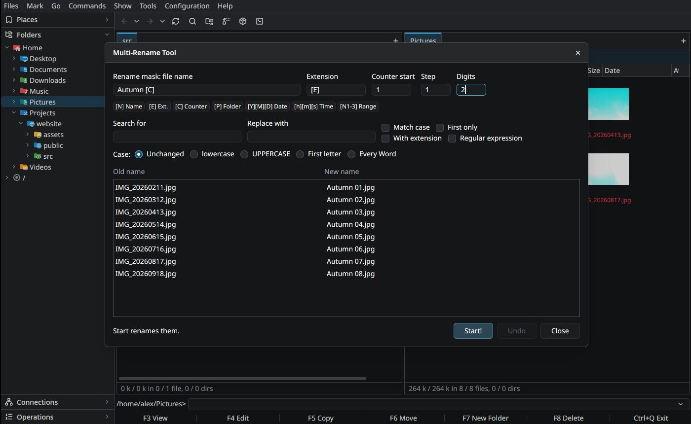
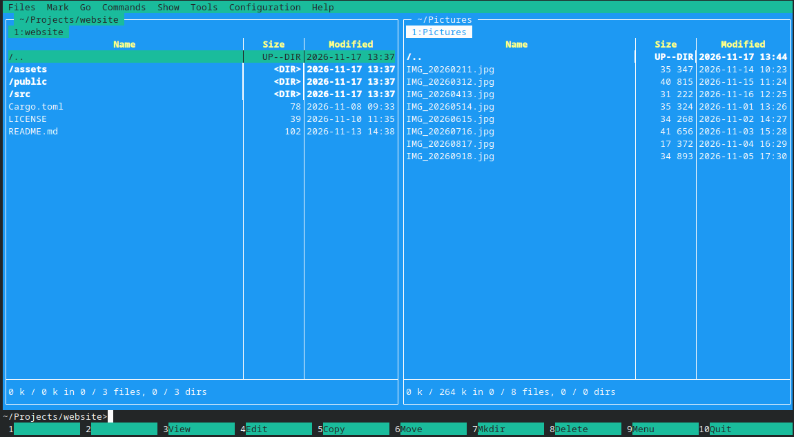

# Spark Commander

A twin-panel file manager for Linux, Windows and macOS, in the tradition of
Total Commander, Krusader and Midnight Commander. It comes in two forms that
share one core: **Spark Commander**, the desktop app, and **scmd**, the same
file manager in a text terminal. Written in Rust; free software under the
GPL.



## What it does

**Panels**
- Two panels with tabs; full, brief or thumbnail view; sorting by name,
  extension, size or time.
- A sidebar with the folder tree, Places (bookmarks, drives, network and
  cloud places, phones through KDE Connect), saved connections and the
  operation queue.
- Workspaces (sets of tabs to switch between), bookmarks, folder history,
  synchronized browsing, a quick filter and a Quick View panel.

**Files**
- Copy and move in the background, queued, with undo and redo; delete to the
  trash or for good.
- Multi-Rename Tool, Synchronize Directories, Compare By Content, search
  (also in its own window), checksums (CRC32, MD5, SHA-1, SHA-256, SHA-512)
  made and verified, split and combine, attributes, links, occupied space.
- Archives open like folders: 7z, zip, rar, tar and others, through the 7-Zip
  that comes with the app, which also packs, unpacks and tests them.

**Viewing and editing**
- A viewer (F3) for text with syntax colouring and other character sets,
  pictures, PDF, HTML and e-books; with the add-ons below also video and
  sound, HEIC and AVIF photos, and Word, Excel and PowerPoint files.
- A built-in editor (F4) with search and a minimap, or the editor of your
  choice.

**Servers and the terminal**
- SFTP and FTP/FTPS; SMB, WebDAV and NFS shares through the system's own
  bridge (kio-fuse on KDE, gvfs on GNOME, the system's clients on Windows and
  macOS).
- With the rclone add-on, S3-compatible storage, Backblaze B2 and OpenStack
  Swift. Google Drive, OneDrive, Dropbox and other services are on the way:
  each needs the app registered with the provider first.
- Passwords are kept in the system's keychain.
- A terminal inside the window, with tabs, and a command line under the
  panels.
- Your own commands in the Tools menu, with placeholders for the panel's
  folder and the selected files.

**Fitting in**
- Key presets of Total Commander, Krusader, Midnight Commander and ForkLift;
  every shortcut can be changed (Configuration › Shortcuts).
- It follows the desktop's look: light or dark, the KDE, GNOME, Windows 11 or
  macOS style of controls, and the sidebar's blur on KDE Plasma and GNOME.
- 36 languages.

## Screenshots

| | |
|---|---|
|  |  |
| Inside a zip archive, with the terminal open | The viewer |
|  |  |
| The Multi-Rename Tool | scmd, in a text terminal |

More, on [Linux, macOS and Windows](docs/screenshots.md).

## Download

There is no packaged release yet: build it from source as below. The
packaging scripts for each system are in [`packaging/`](packaging).

## Building from source

You need a recent stable [Rust](https://rustup.rs) (edition 2024) and, on
Linux, the development files of the usual desktop libraries. On Debian and
Ubuntu:

```sh
sudo apt install build-essential pkg-config clang cmake \
    libxkbcommon-dev libxkbcommon-x11-dev libwayland-dev libvulkan-dev \
    libfontconfig1-dev libfreetype-dev libx11-dev libx11-xcb-dev libxcb1-dev \
    libxcb-xkb-dev libxi-dev libdbus-1-dev libssl-dev libzstd-dev libasound2-dev
```

7-Zip and PDFium are not kept in git. Fetch them once after cloning (they are
checked against their published checksums), then build and run:

```sh
git clone https://github.com/remoxio/spark-commander.git
cd spark-commander
vendor/7zip/fetch.sh && vendor/pdfium/fetch.sh   # Windows: vendor\7zip\fetch.bat, vendor\pdfium\fetch.bat

cargo run -p sc-gui    # Spark Commander
cargo run -p sc-tui    # scmd
```

`cargo build --release -p sc-gui -p sc-tui` builds both programs,
`sparkcommander` and `scmd`. For a release folder with everything that goes
with them, see [Linux](packaging/linux/README.md),
[macOS](packaging/macos/README.md) and [Windows](packaging/windows/README.md).

| Crate | What it is |
|---|---|
| `sc-core` | everything the file manager does: panels, operations, archives, servers, viewers' content, settings |
| `sc-gui` | the desktop app, on [GPUI](https://www.gpui.rs) and GPUI Kit |
| `sc-tui` | scmd, on [ratatui](https://ratatui.rs) |
| `sc-qtstyle`, `sc-gtkstyle` | small helpers that let KDE's Qt style or a GTK 3 theme draw the controls |

## Add-ons

The app works without them; Configuration › Settings › Add-ons downloads the
ones for your system, and the app offers them when a file needs one.

| Add-on | For |
|---|---|
| rclone | online storage |
| libmpv | video and sound, HEIC and AVIF photos |
| Craft tools | Word, Excel and PowerPoint files, shown as PDF |

7-Zip (archives) and PDFium (PDF) come with the app itself.

## Translations

The words of both programs are in [`l10n/`](l10n), one file per language,
with English as the source; [`l10n/README.md`](l10n/README.md) explains the
format.

## License

Spark Commander is free software: you can redistribute it and/or modify it
under the terms of the [GNU General Public License](LICENSE), version 3 or
(at your option) any later version.

The programs and libraries that come with it keep their own licenses: Help ›
About lists them, and a release folder carries their license files. The
patched GPUI Kit crates in [`vendor/`](vendor) are Apache-2.0.
