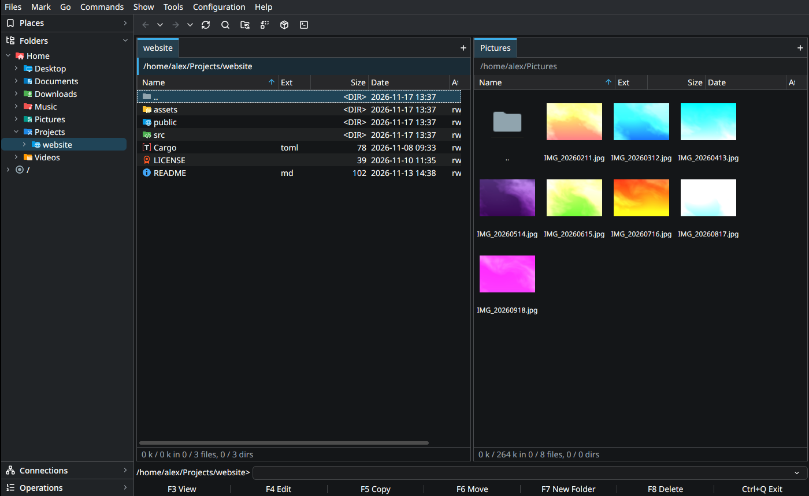
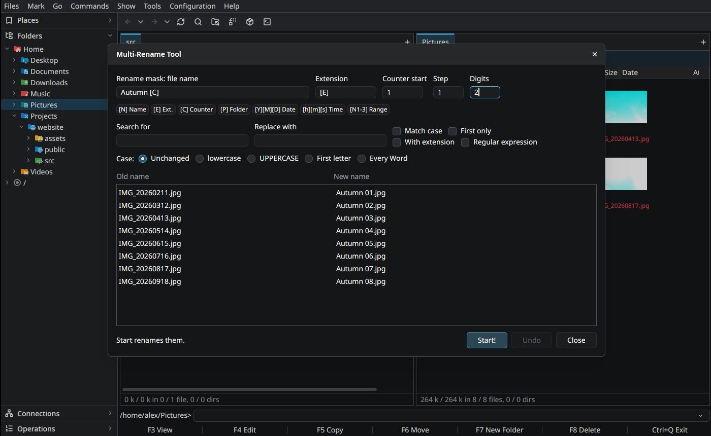
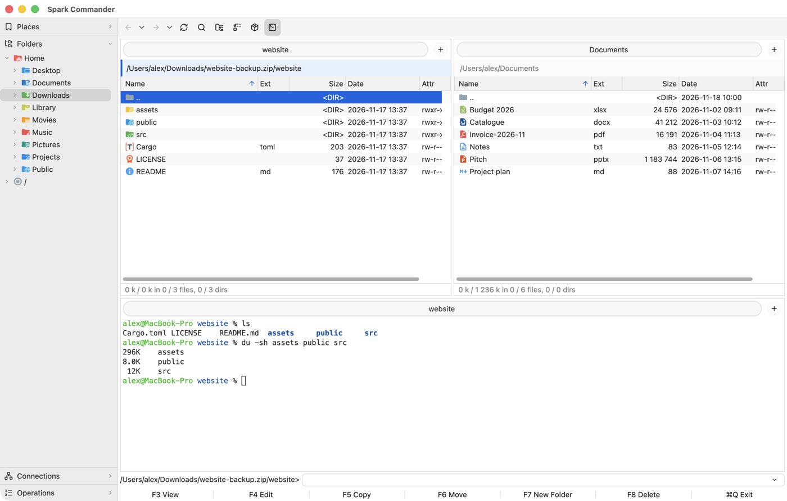
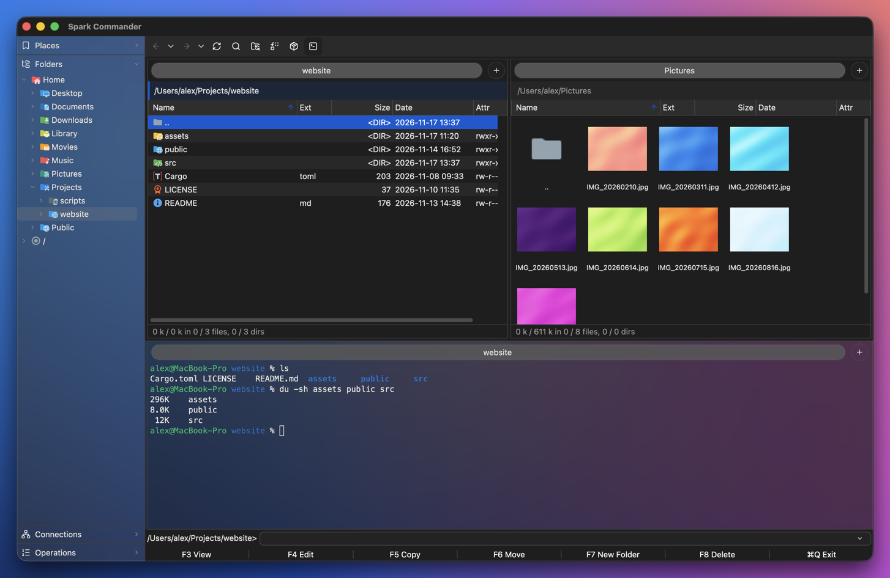
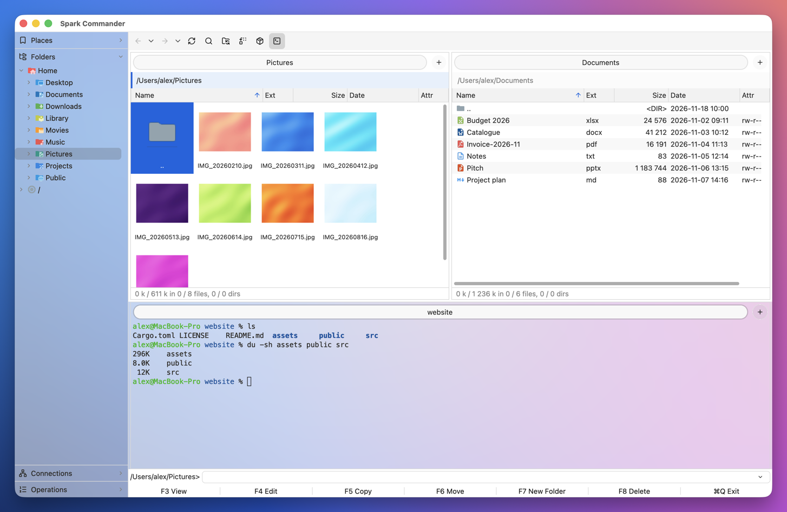

# Screenshots

Spark Commander takes on the look of the desktop it runs on: its controls,
menus and keys, light or dark. The files shown are a made-up user's, alex's.

- [Linux](#linux)
- [macOS](#macos)
- [Windows](#windows)

## Linux

On KDE Plasma, with the Breeze style.

| | |
|---|---|
|  |  |
| Inside a zip archive, with the terminal open | The viewer |
|  |  |
| The Multi-Rename Tool | scmd, in a text terminal |

## macOS

On macOS 26, with AppKit's controls: Finder's tabs, the system's accent
colour, the menus in the menu bar.

| | |
|---|---|
|  |  |
| Inside a zip archive, with the terminal open | The viewer |
|  |  |
| The editor | The Multi-Rename Tool |
|  |  |
| The sidebar and the terminal see-through, blurred | The same in the light look |
|  | |
| Settings › Add-ons | |

## Windows

Screenshots from Windows 11 are still to come.
