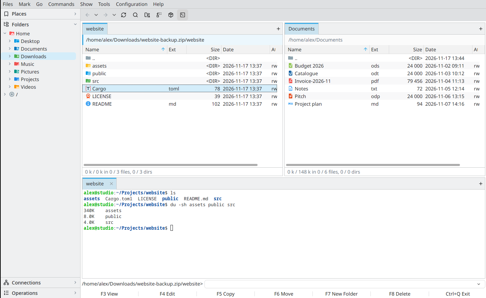
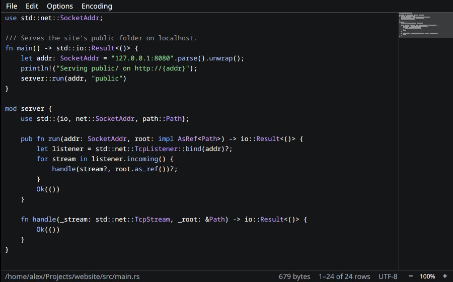
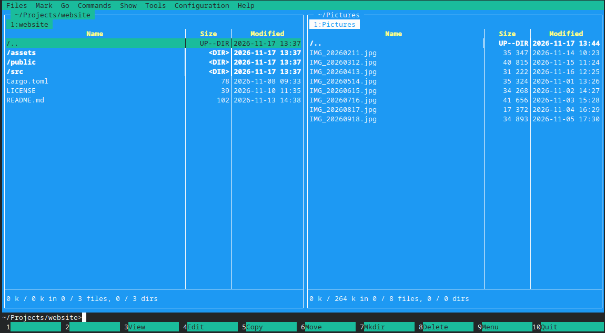

# Screenshots

Spark Commander takes on the look of the desktop it runs on: its controls,
menus and keys, light or dark. The files shown are a made-up user's, alex's.

- [Linux](#linux)
- [macOS](#macos)
- [Windows](#windows)

## Linux

On KDE Plasma, with the Breeze style.

| | |
|---|---|
|  |  |
| Inside a zip archive, with the terminal open | The viewer |
|  |  |
| The Multi-Rename Tool | scmd, in a text terminal |

## macOS

Screenshots from macOS 26 are still to come.

## Windows

Screenshots from Windows 11 are still to come.
